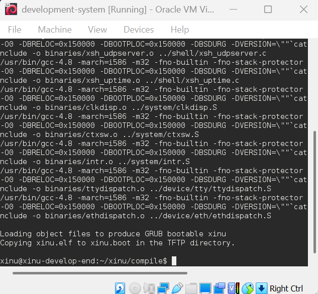
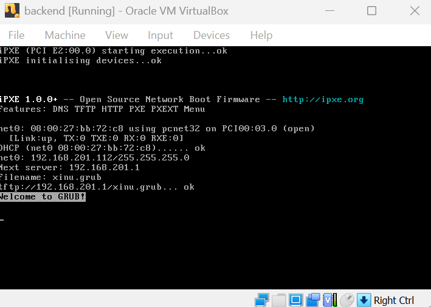
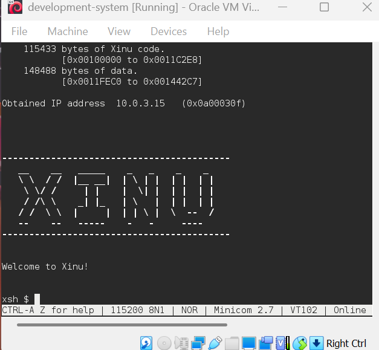
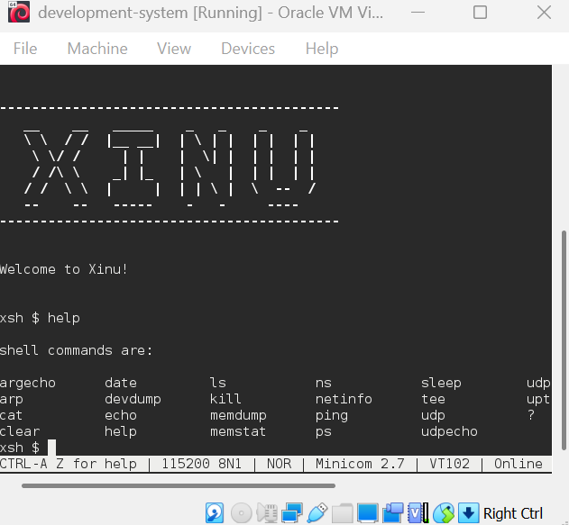

# Laporan Praktikum Sistem Operasi

## Modul 1, 2, dan 3: Instalasi, Arsitektur, dan Eksplorasi Xinu OS

### Identitas Praktikan

| Item | Keterangan |
| --- | --- |
| Nama | Ringgas Noble Friston Lubis |
| NIM | 108072500137 |
| Kelas | IF-05-04 |
| Asisten Praktikum | Nuevalen Refitra Alswando |
| Tanggal Praktikum | 02-10-2026 |

---

## 1\. Tujuan Praktikum

1. Mengenali ketentuan praktikum Sistem Operasi serta mempersiapkan perangkat lunak yang diperlukan, meliputi VirtualBox, Ubuntu, Xinu OS, dan Sourcetrail.
2. Mempelajari konsep _cross-development_ pada Xinu OS dengan memahami pembagian fungsi antara Development-System VM sebagai lingkungan pengembangan dan Backend VM sebagai mesin target.
3. Mempraktikkan proses pembangunan (_build_) source code Xinu hingga menghasilkan image sistem operasi yang dapat dijalankan melalui mekanisme network booting menggunakan PXE dan TFTP.
4. Memahami cara berkomunikasi dengan sistem Xinu yang sedang berjalan serta mencoba perintah-perintah dasar melalui shell dengan bantuan Minicom dan koneksi serial.

---

## 2\. Dasar Teori & Arsitektur Sistem

Xinu OS merupakan sistem operasi yang dirancang dengan struktur relatif sederhana untuk mempelajari konsep-konsep sistem operasi dan mendukung lingkungan embedded. Salah satu pendekatan pengembangannya adalah _cross-development_, yaitu proses pembuatan perangkat lunak pada sebuah mesin pengembang yang berbeda dari mesin tempat perangkat lunak tersebut dijalankan. Dengan metode ini, proses penulisan dan kompilasi program dilakukan pada host, sedangkan hasil kompilasinya dipindahkan ke perangkat target untuk dieksekusi.

Lingkungan praktikum ini menerapkan konsep tersebut melalui dua Virtual Machine (VM) yang memiliki fungsi berbeda:

1. **Development-System VM:** Berperan sebagai lingkungan kerja pengembang yang menggunakan Debian Linux. Mesin ini menyediakan source code Xinu, compiler, serta layanan DHCP dan TFTP yang diperlukan selama proses kompilasi dan booting jaringan.
2. **Backend VM:** Bertindak sebagai mesin target untuk menjalankan Xinu OS. Sistem operasi dimuat melalui jaringan menggunakan PXE, dengan image yang disediakan oleh TFTP server pada Development-System VM. Koneksi virtual serial menghubungkan kedua mesin agar aktivitas pada console Xinu dapat diamati dan dikendalikan dari terminal mesin pengembang.

Pembagian tugas tersebut memungkinkan proses pengembangan berlangsung pada satu mesin, sementara pengujian hasil kompilasi dilakukan pada mesin lain. Dengan demikian, praktikan dapat mempelajari hubungan antara proses pembangunan sistem operasi, distribusi image melalui jaringan, dan eksekusi sistem pada perangkat target.

---

## 3\. Langkah Kerja dan Hasil Eksplorasi

### 3.1 Login dan Kompilasi Source Code Xinu

Tahap awal praktikum dimulai dengan menjalankan Development-System VM dan masuk ke sistem Debian Linux menggunakan akun yang telah disediakan. Setelah proses login selesai, terminal digunakan untuk mengakses direktori kompilasi Xinu.

- Username: `xinu`
- Password: `xinurocks`

Sebelum membangun ulang sistem, direktori kerja dibersihkan dari hasil kompilasi sebelumnya. Langkah ini bertujuan agar proses _build_ dilakukan kembali dengan kondisi hasil kompilasi yang bersih.

$ cd xinu/compile $ make clean $ make

**Hasil:** Perintah `make` menjalankan proses kompilasi source code Xinu dan menghasilkan file executable `xinu.elf`. Setelah proses pembangunan selesai, image tersebut juga disalin ke lokasi layanan TFTP, yaitu `/srv/tftp/xinu.boot`, sehingga dapat diambil oleh Backend VM ketika melakukan booting melalui jaringan.

Gambar 1: Proses pembangunan ulang Xinu OS menggunakan perintah `make` pada Development-System VM.

### 3.2 Booting Backend VM via PXE

Setelah image Xinu tersedia pada server TFTP, tahap berikutnya adalah menjalankan Backend VM. Karena mesin target tidak menggunakan sistem operasi yang dipasang pada hard disk lokal, proses pemuatan sistem dilakukan melalui jaringan dengan mekanisme PXE (_Preboot Execution Environment_).

Urutan proses booting yang diamati adalah sebagai berikut:

1. Backend VM memulai proses booting dan menampilkan GRUB sebagai bootloader.
2. Melalui antarmuka jaringan virtual, Backend VM mengirimkan permintaan konfigurasi jaringan kepada DHCP Server pada Development-System VM.
3. Setelah memperoleh konfigurasi jaringan, Backend VM mengambil image `xinu.boot` dari TFTP server.
4. Image yang berhasil dimuat kemudian dijalankan sehingga Xinu OS dapat beroperasi pada mesin target.

**Hasil:** Backend VM dapat memulai sistem operasi melalui jaringan tanpa memerlukan instalasi sistem operasi pada media penyimpanan lokal. Tahapan ini memperlihatkan keterkaitan antara layanan DHCP, transfer file melalui TFTP, dan proses booting berbasis PXE.

Gambar 2: Tampilan Backend VM ketika memulai booting melalui jaringan menggunakan PXE dan memuat GRUB.

### 3.3 Koneksi Serial Port menggunakan Minicom

Interaksi dengan Xinu OS dilakukan dari Development-System VM melalui koneksi serial virtual. Untuk mengakses console mesin target, praktikan membuka aplikasi Minicom pada terminal. Karena konfigurasi koneksi yang digunakan memerlukan hak akses administratif, aplikasi dijalankan menggunakan `sudo`.

$ sudo minicom

Password: `xinurocks`

**Hasil:** Setelah koneksi serial berhasil terbentuk, terminal Development-System VM dapat digunakan untuk berinteraksi dengan Xinu yang berjalan pada Backend VM. Indikator keberhasilan koneksi terlihat dari perubahan prompt terminal menjadi `xsh$`, yang menandakan bahwa input perintah kini ditangani oleh shell Xinu, bukan lagi oleh shell Debian.

Gambar 3: Tampilan terminal setelah koneksi Minicom berhasil dan prompt Xinu Shell `xsh$` muncul.

### 3.4 Eksplorasi Perintah Shell Xinu

Setelah berhasil masuk ke Xinu Shell, praktikan melanjutkan pengujian dengan mencoba perintah bawaan yang tersedia. Berbeda dari shell Linux, Xinu memiliki kumpulan perintah yang disesuaikan dengan implementasi dan fasilitas yang disediakan oleh sistem operasi tersebut.

Perintah `help` digunakan terlebih dahulu untuk menampilkan daftar perintah yang dapat dikenali oleh shell.

xsh$ help

Gambar 4: Keluaran perintah `help` yang memperlihatkan daftar perintah bawaan Xinu OS.

Selain menampilkan daftar perintah, eksplorasi juga dilakukan terhadap operasi direktori menggunakan `ls` dan `cd` untuk mengenali fasilitas sistem file yang tersedia. Praktikan turut mempelajari perintah penghentian sistem, seperti `halt` atau `shutdown`, apabila perintah tersebut tersedia pada implementasi Xinu yang digunakan.

**Hasil:** Pengujian ini memberikan gambaran awal mengenai cara menerima perintah, menampilkan informasi sistem, dan menggunakan fasilitas dasar yang disediakan oleh Xinu Shell. Eksplorasi tersebut juga membantu membedakan lingkungan perintah Xinu dari lingkungan terminal Linux.

---

## 4\. Pembahasan

Berdasarkan tahapan praktikum, terdapat beberapa konsep penting yang dapat dipahami dari proses instalasi, kompilasi, dan pengoperasian Xinu OS.

1. **Pemisahan Lingkungan Pengembangan dan Mesin Target (****_Cross-Development_****):** Penggunaan dua VM menunjukkan bahwa proses pengembangan tidak harus dilakukan pada perangkat yang menjalankan hasil program. Development-System VM menyediakan lingkungan untuk mengelola source code dan membangun image, sedangkan Backend VM digunakan untuk menguji image tersebut. Pendekatan ini relevan pada pengembangan sistem embedded yang memiliki keterbatasan sumber daya atau fasilitas pengembangan.

2. **Mekanisme Booting Jaringan dengan PXE dan TFTP:** Backend VM dapat menjalankan Xinu tanpa bergantung pada instalasi sistem operasi di penyimpanan lokal. Ketika proses booting dimulai, antarmuka jaringan meminta konfigurasi melalui DHCP. Informasi jaringan tersebut memungkinkan mesin target mengakses layanan TFTP untuk mengambil image `xinu.boot`. Image kemudian dimuat ke memori untuk menjalankan sistem operasi. Keberhasilan mekanisme ini bergantung pada konfigurasi jaringan dan ketersediaan layanan yang diperlukan.

3. **Fungsi Serial Port dan Minicom:** Koneksi serial berperan sebagai jalur komunikasi antara mesin pengembang dan mesin target. Pada lingkungan yang tidak mengandalkan antarmuka grafis di Backend VM, koneksi tersebut memungkinkan praktikan mengirimkan input dan melihat keluaran sistem melalui terminal. Minicom berfungsi sebagai aplikasi terminal yang memfasilitasi komunikasi tersebut, sehingga aktivitas Xinu dapat dipantau tanpa berinteraksi langsung dengan perangkat keras target.

4. **Cara Kerja Xinu Shell (****`xsh$`****):** Xinu Shell menyediakan antarmuka sederhana untuk menerima dan menjalankan perintah sistem. Secara umum, implementasi shell membaca masukan, mengenali nama perintah, kemudian menghubungkannya dengan fungsi yang sesuai. Pada implementasi Xinu yang digunakan dalam praktikum, perintah seperti `help`, `uptime`, dan `kill` dapat digunakan untuk mengakses fasilitas tertentu apabila tersedia. Berbeda dari sistem operasi modern yang menerapkan pemisahan ruang pengguna dan kernel secara lebih ketat, Xinu memiliki model eksekusi yang lebih sederhana sesuai tujuan desainnya.

---

## 5\. Kesimpulan

1. Praktikum memberikan pemahaman awal mengenai tata tertib laboratorium, persiapan perangkat lunak, dan penggunaan Oracle VM VirtualBox sebagai sarana untuk membangun lingkungan pengembangan Xinu OS.
2. Arsitektur _cross-development_ pada praktikum memisahkan Development-System VM sebagai mesin pengembangan dan penyedia layanan jaringan dari Backend VM yang berfungsi sebagai mesin target untuk menjalankan sistem operasi.
3. Proses kompilasi melalui perintah `make` menghasilkan image Xinu yang dapat disediakan melalui TFTP dan dimuat oleh Backend VM menggunakan mekanisme booting PXE.
4. Koneksi serial melalui Minicom memungkinkan praktikan mengakses Xinu Shell dengan prompt `xsh$` serta mengenali sejumlah perintah dasar yang tersedia. Pengalaman ini menjadi landasan untuk mempelajari implementasi internal Xinu, termasuk pengelolaan proses dan penggunaan system call pada praktikum berikutnya.